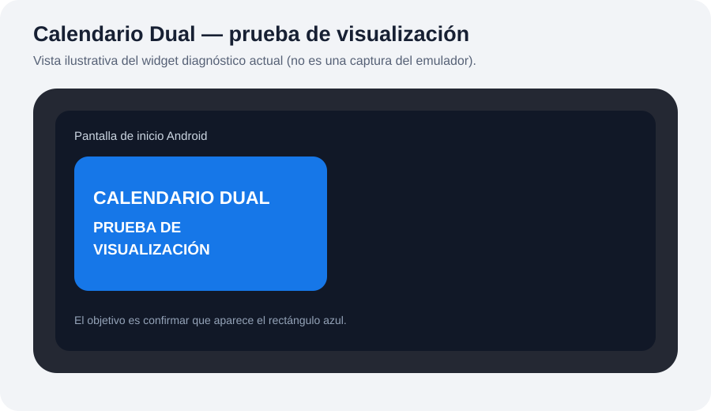

# Calendario dual para Android

## Vista previa del widget de prueba

> **Importante:** esta es una maqueta ilustrativa de la prueba actual, no una captura de un emulador Android. La versión de prueba intenta mostrar un rectángulo azul con el texto “CALENDARIO DUAL — PRUEBA DE VISUALIZACIÓN”. Primero confirmaremos que se renderiza; después restauraremos el calendario mensual y la agenda semanal.

## Objetivo del widget completo
Widget de solo visualización: eventos semanales de Google Calendar sincronizados con Android y calendario Outlook publicado mediante ICS, con mini calendario mensual.

## Compilar
Abre esta carpeta en Android Studio, instala Android SDK 35, sincroniza Gradle y ejecuta Build > Build APK(s). Instala el APK, abre la aplicación, pega el enlace ICS y concede permiso de lectura de calendarios. Luego añade el widget desde el selector de widgets Android.

## Estado
La compilación automática de la versión de diagnóstico terminó correctamente en GitHub Actions. Aún falta verificar la visualización en un dispositivo o emulador Android. El lector ICS cubre eventos básicos; recurrencias y zonas horarias especiales requieren pruebas. El widget no edita eventos. No publiques tu enlace ICS: puede dar acceso a tu calendario a quien lo tenga.

La compilación automática se ejecuta desde GitHub Actions en la rama `calendario-dual`.
